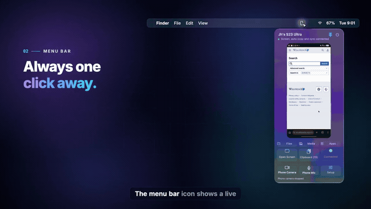
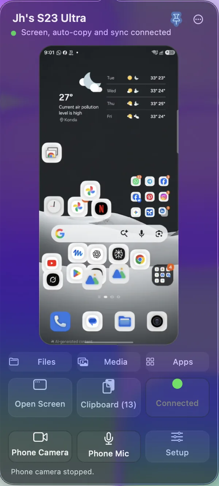
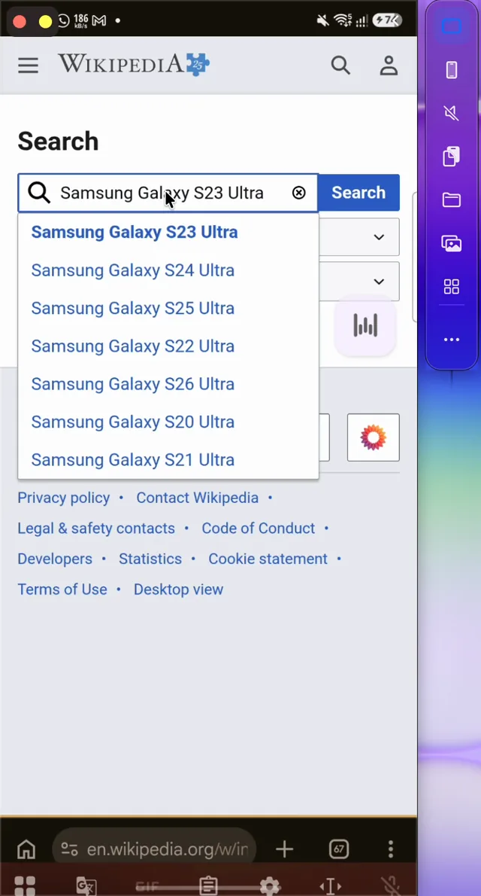
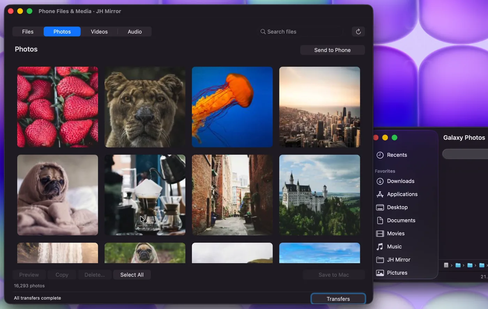
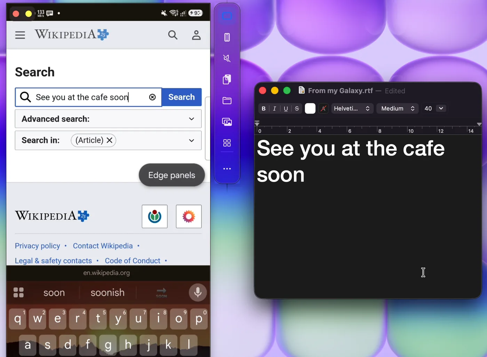
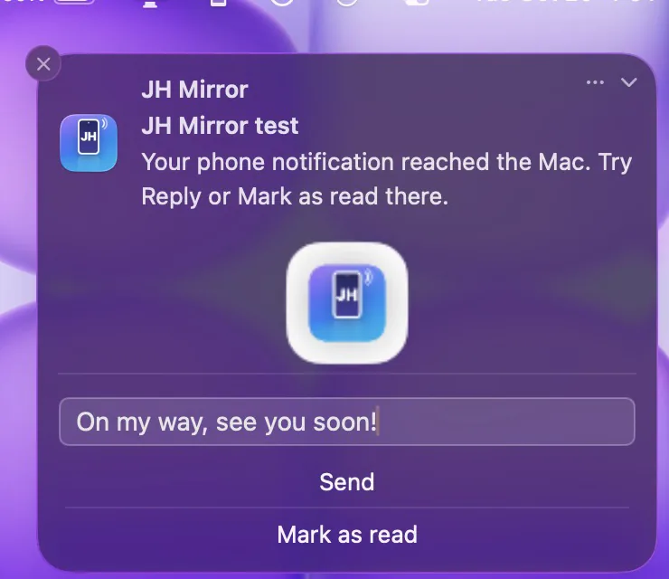

  

<h1 align="center">JH Mirror</h1>

  Your Android phone, on your Mac. 
  Screen, notifications, photos, files, and clipboard. Free.

  <a href="https://github.com/imjhakash/jh-mirror/releases/download/v4.15.0/JH-Mirror-4.15.0.dmg"><strong>Download for Mac</strong></a>
  &nbsp;·&nbsp; Apple silicon &nbsp;·&nbsp; macOS 26

  

## See it

  
  &nbsp;
  
  &nbsp;
  

  
  &nbsp;
  

The moving preview above is a short piece of the [full video](website/assets/video/jh-mirror-promo-720.mp4). The pictures are the same ones used on the website.

## What it does

- See and control the phone in a Mac window, with sound.
- Phone notifications show on the Mac. You can reply from there.
- Copy on the phone, paste on the Mac.
- Browse photos and files, and drag them into Finder.
- Use the phone camera for a Mac call.

## Install

1. Download the file and drag **JH Mirror** into **Applications**.
2. The first open may need **System Settings → Privacy & Security → Open Anyway**.
3. On the phone, turn on **Wireless debugging** and scan the code. Android 11 or newer, same Wi-Fi.

The phone app installs by itself. No separate download.

## Who made it

**Johirul Hoq Akash**, with **Claude** and **Codex**.

Screen mirroring is built on [scrcpy](https://github.com/Genymobile/scrcpy) (Apache 2.0).

The longer setup and build notes are in [docs/GUIDE.md](docs/GUIDE.md). The website is in [website/](website/).
